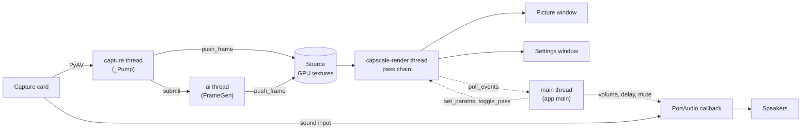

# Architecture

CapScale is one Python package with a Rust extension inside it.

- **Rust** (`src/`, built as `capscale._core`) owns the two windows, the GPU and
  the settings UI. Everything that must happen once per displayed picture is here.
- **Python** (`python/capscale/`) owns everything around it: reading the capture
  card, repeat detection, the AI model, sound, `config.toml`, hotkeys and the
  command line.

The split follows what each side is good at. PyAV, sounddevice and ONNX Runtime
are Python libraries; a render loop that must not miss a display refresh is not a
job for Python. The boundary between them is one class, `Renderer`
([Python API](python-api.md)).

## Threads



| Thread | Started by | Does |
|---|---|---|
| main | the process | `app.main`: every 20 ms it hands frame generation settings to the capture thread and sound settings to the audio stream, handles window events and hotkeys, reloads `config.toml`, restarts a dead capture thread |
| `capture` | `app._Pump` | opens the card, reads frames, drops repeated frames when frame generation is on, hands each frame to the renderer or to the AI thread |
| `ai` | `ai.FrameGen`, only if the AI download is installed | loads the model, generates in-between frames, pushes them and the real frame at their times |
| `capscale-render` | `Renderer()` (`render::window::spawn`) | the winit event loop: both windows, the pass chain, the egui UI, shader hot reload |
| PortAudio callback | `audio.Audio` | copies the card's sound to the output through a delay line |
| LUT dialog | "Load .cube..." | a native file dialog blocks its caller, so it gets its own short-lived thread |

winit allows one event loop per process, so there is one `Renderer` per process.

## A frame's journey

1. **Read.** `capture.stream.Capture.frames()` yields
   `(data, fmt, width, height, full_range, matrix, decode_ms)`. Raw video (NV12,
   YUY2) is passed on as the packet's bytes, with no copy and no decode. MJPEG is
   decoded by FFmpeg to planar YUV. Frames that were already queued when asked for
   (they arrive in under a millisecond) are skipped, up to four in a row, so a
   backlog cannot build into delay.
2. **Thin out.** With frame generation on, `capture.repeats.Cadence` decides
   whether this frame is a repeat of the last one; repeats are dropped.
3. **Hand over.** `Renderer.push_frame` validates the layout and copies the pixels
   into the source textures (`source::Source::upload`), with the Python lock
   released. A newer frame simply replaces the older one: nothing queues. It then
   wakes the render thread.
4. **Draw.** The render thread runs the [pass chain](pipeline.md) and presents.
5. **Report.** Timings go into `Stats`, which the overlay, the settings window and
   `Renderer.stats` read.

With the AI method, step 3 goes to `ai.FrameGen.submit` instead; that thread
pushes the generated frames and then the real one. See
[Frame generation](frame-generation.md).

## State shared between threads

`render::Shared` (`src/render/types.rs`) is held by both the `Renderer` object and
the render thread. Each field has its own mutex and is locked only for a copy.

| Field | Written by | Read by |
|---|---|---|
| `source` | `push_frame` | render thread, each draw |
| `params` | `set_params`, `toggle_pass`, both windows' UI | render thread; Python through the `framegen`, `audio`, `hud_zones`, `ai_still` getters |
| `lut` | `set_params(lut_path=...)`, the LUT dialog | render thread, which uploads it when its generation number moves |
| `stats` | render thread | UI, `Renderer.stats` |
| `events` | render thread | `Renderer.poll_events` |
| `sources` | `Renderer.set_sources`, the Source tab | the Source tab |
| `closed` | render thread on exit | `push_frame`, which then raises |

A panic on one thread does not take the other down with a poisoned lock: `lock()`
takes the data either way, since it is plain values.

### Settings are one struct

`params::Params` holds every tunable. There are three ways to change it and they
all end in the same place:

```
settings window ──┐
set_params / toggle_pass ──┼──> Params ──> Globals (uniform block) ──> shaders
config.toml (via app._apply) ──┘        └──> to_toml() ──> config.save_sections()
```

`Params::clamp` keeps every value inside the range the shaders are written for.
`Params::to_toml` writes the sections the settings window owns; `panel` and
`capture` are left out because they are window state, not settings.

### Events back to Python

The render thread cannot call Python, so it queues events and the main loop polls
them. A key press becomes an action through the `[hotkeys]` table; everything else
is acted on directly.

| Event | Raised when | Main loop does |
|---|---|---|
| `key` | a key is pressed on the picture window (not while a UI field has focus) | looks the action up in `[hotkeys]` |
| `start` | **Start capture** | writes `last_source.json`, starts the capture thread and sound |
| `stop` | **Stop**, or the picture window is closed | stops the capture thread and sound |
| `refresh_sources` | **Refresh devices** | lists devices and modes again |
| `save` | **Save to config.toml** | `config.save_sections` |
| `closed` | the settings window is closed | exits |

## Windows and when they redraw

`render::window` owns two windows on one GPU device.

- The **picture window** is hidden until capture starts. It redraws when a frame
  is pushed, when a generated frame is due (`next_tick`), when a shader was
  reloaded, and for the UI at most once per 16 ms: a mouse reports movement up to
  1000 times a second, and without that gap each report would run the whole
  pipeline.
- The **settings window** is egui only. It redraws when its UI changed and four
  times a second for the live numbers in it. It always presents with `fifo`.

`sync_windows` shows and hides them to match `Params::capture` and
`Params::panel`. With capture off the settings window is always shown, so there is
never a state with no window on screen.

## What happens when something fails

| Failure | Handling |
|---|---|
| start-up (no GPU, no window) | `Renderer()` raises; `app.gui` shows the message in a native box, because the shortcut has no console |
| the capture thread dies (card unplugged, taken by another program) | the overlay shows `capture: ... - retrying` and a new thread is started every second |
| no matching sound input | printed as `audio: ...`; the picture runs without sound |
| `config.toml` does not parse, or has a wrong key | printed as `config: ...`; the previous values stay |
| a shader does not compile on hot reload | the running version is kept and the error shows in the stats overlay |
| the AI model fails to load or run | the status line says so and the built-in method takes over |
| a `.cube` file is bad | a message box from the LUT dialog, or `ValueError` from `set_params` |

## Source map

### Rust (`src/`)

One folder per concern. Each has its types in `types.rs` and, where it exposes
something to Python, the bindings in `python.rs`.

| Path | Holds |
|---|---|
| `lib.rs` | the module list and the `_core` Python module |
| `render/window.rs` | the render thread: both windows, the per-draw loop, the frame generation schedule |
| `render/pipeline.rs` | the pass chain: targets, bind groups, `encode` |
| `render/shaders.rs` | `ShaderDir`: WGSL files, `common.wgsl` in front, change detection |
| `render/timing.rs` | per-pass GPU time from timestamp queries |
| `render/python.rs` | the `Renderer` class |
| `render/types.rs` | `Shared`, `Stats`, `Event`, `Step`, the pass and slot constants |
| `params/types.rs` | `Params`, the enums, `Globals` (the uniform block) |
| `params/settings.rs` | `toggle`, `clamp`, `reset_look`, `to_toml` |
| `params/globals.rs` | `Globals::new`, `yuv_rows`, `wb_gains` |
| `params/plan.rs` | `frame_plan`, `snap_fps`, `fit` |
| `params/python.rs` | `yuv_matrix`, `frame_plan` for Python |
| `source/` | `Fmt`, `Plane`, `Source`: the captured frame as GPU textures |
| `lut/` | `.cube` parser and 3D texture |
| `ui/overlay.rs` | the stats overlay, HUD zone frames, every tab of the settings window |
| `ui/dialog.rs` | native file and message dialogs |

### Python (`python/capscale/`)

| Path | Holds |
|---|---|
| `__init__.py` | re-exports `Renderer` |
| `app.py` | command line, the main loop, the capture thread (`_Pump`) |
| `config.py` | defaults, load, save, `Watcher` |
| `capture/devices.py` | list devices and modes (DirectShow on Windows, V4L2 on Linux), `best_mode` |
| `capture/stream.py` | `Capture`: open the card, yield frames |
| `capture/pattern.py` | `Pattern`: colour bars with the same interface as `Capture` |
| `capture/repeats.py` | `Cadence`: spot repeated frames |
| `capture/types.py` | `Mode`, `Frame` |
| `audio.py` | `Audio`: the card's sound to the speakers, `DelayLine` |
| `ai/engines.py` | `ENGINES` (TensorRT, DirectML), `session`: a model file loaded on the graphics card |
| `ai/pack.py` | the AI download: `PACK`, `available`, `models` |
| `ai/model.py` | `Model`: one installed model for one frame size |
| `ai/framegen.py` | `FrameGen` (the AI thread), `planes_of`, `keep_zones` |
| `ai/check.py` | times the real model and scores its output (`python -m capscale.ai`) |
| `ai/types.py` | `Planes`, `FrameModel`, `Engine` |
| `shaders/` | one WGSL file per pass, shipped as package data so they can be edited in place |

### Around them

| Path | Holds |
|---|---|
| `scripts/` | `build-installer.ps1`, `install-ai.ps1`, `build_ai_model.py`, `install-shortcut.ps1` |
| `packaging/` | the PyInstaller entry script, the Inno Setup script, the icon and its generator, the installer's getting-started text |
| `tests/rust/`, `tests/python/` | see [Development](development.md#tests) |
